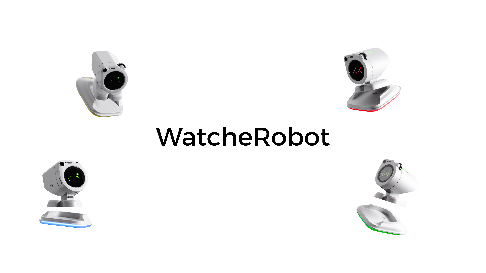

English | [简体中文](README_zh.md)

# WatcheRobot

## Product introduction

WatcheRobot is a programmable desktop robot for desktop companionship, interactive demos, and robot application development. It expresses itself through screen expressions, movement, lights, and sound, and responds to touch, camera, and microphone input—giving your applications a physical way to interact.

- **Express**: animations, code-generated expressions, head pan and tilt, light colors and effects, sounds, and audio playback.
- **Sense**: photos, microphone capture, back touch, screen taps, and roller input.
- **Interact**: face tracking, recording, and real-time audio/video; voice conversations connect AI services through an application.
- **Create**: build computer-side applications with the Python SDK, explore device-side logic with the C SDK preview, or assemble your own robot from the published files.

[Explore all capabilities and APIs](wiki/guides/en/products/watcherobot/capabilities.md)

## Quick Start

Already have a robot? Start by connecting and using it:

1. **Install a client**: get a computer or phone installer from the [device guide](wiki/guides/en/products/watcherobot/device-guide.md#install-app).
2. **Set up Wi-Fi**: scan the robot's QR code in the phone App and complete **2.4 GHz Wi-Fi** setup (**5 GHz is not supported**); see [Wi-Fi setup](wiki/guides/en/products/watcherobot/device-guide.md#wifi).
3. **Connect the robot**: choose Desktop Link on a computer or Phone Control on a phone; see [connection instructions](wiki/guides/en/guide/getting-started.md).
4. **Try it out**: follow the [first-run check](docs/action-test.md) for expressions, lights, and movements within a safe range.

## Develop and build

**Recommended:** [Create an app with an AI agent](wiki/guides/en/guide/create-with-agent.md). Copy one prompt, describe your idea and let the agent use the complete downloadable Skill.

| What you want to do | Start here |
| --- | --- |
| Create your first Python robot app | Recommended: [AI agent + Skill quick start](wiki/guides/en/guide/create-with-agent.md); [manual development](docs/sdk.md) |
| Build a voice conversation app | [Voice conversations](wiki/guides/en/products/watcherobot/voice.md) |
| Write device-side programs | [Standalone C SDK (development preview)](https://github.com/orulink-ai/WatcheRobot_c_sdk); [fetch the `c-sdk` submodule and get started](docs/embedded-sdk.md) |
| Build your own robot | [DIY build guide](wiki/guides/en/guide/reproduction.md) |
| Download hardware files, BOMs, firmware, and assets | [Resources and downloads](hardware/README.md) |

## Get your robot

[Pre-order WatcheRobot on JD.com](https://item.jd.com/100326823811.html) (China). See the product page for pre-order terms and delivery estimates. International purchasing channels are coming soon.

## Community and support

[WeChat, Discord, issue reporting, and contributions](wiki/guides/en/products/watcherobot/community.md) · [Troubleshooting](wiki/guides/en/troubleshooting/index.md)

## Open source and licensing

Published materials include hardware production files, mechanical models, the Python SDK, flashing tools, and documentation; the [standalone C SDK](https://github.com/orulink-ai/WatcheRobot_c_sdk) is a development preview, with current source, examples and guides maintained in its own repository. Official ESP32-S3 application, STM32, Himax, client, and server implementations are not published in this repository.

This repository uses [GPL-3.0](LICENSE). Subprojects and third-party components retain their own licenses.
