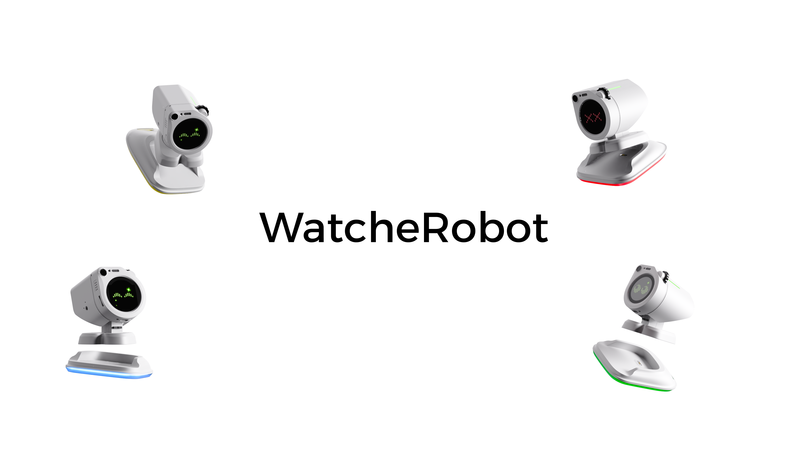

English | [简体中文](README_zh.md)

# WatcheRobot

Online documentation: **[wiki.orulink.ai](https://wiki.orulink.ai/en/)**. The Wiki builds from this repository and follows stable Releases. See [maintenance and publishing](wiki/README.en.md).

The public WatcheRobot desktop-robot repository provides hardware files, mechanical models, the Python SDK, flashing tools, user guides, and Release asset documentation.

## Get Your Robot

Prefer a finished robot without sourcing parts and assembling it yourself? **[Pre-order WatcheRobot on JD.com](https://item.jd.com/100326823811.html)** (China).

International purchasing channels are coming soon. We will add the links here when they launch. See the JD.com product page for pre-order details and delivery estimates.

Want to build your own? Follow the [DIY build guide](wiki/guides/en/guide/reproduction.md) for hardware resources, assembly, and flashing instructions.

## Project Preview

WatcheRobot is designed for desktop companionship, interactive demos, and developer experiments. It combines a Watcher head, ESP32-S3, an STM32 body board, servos, mechanical parts, and SD-card resources. You can use it through Desktop, the mobile App, or the Python SDK.

## Quick Start

For users who already have a working, assembled robot. Cloning the repository, preparing flashing tools, or reflashing is not required.

1. **Power on and install a client**: download an installer for your computer or phone from the [device guide](wiki/guides/en/products/watcherobot/device-guide.md#install-app).
2. **Configure networking**: scan the robot's QR code in the phone App and complete [Wi-Fi setup](wiki/guides/en/products/watcherobot/device-guide.md#wifi).
3. **Connect the robot**: use Desktop Link for a computer or SDK, and Phone Control for phone control; see [Getting started](wiki/guides/en/guide/getting-started.md).
4. **Start using it**: perform the [first-run check](docs/action-test.md) for expressions, lights, and movements within a safe range.

For application development, see the [SDK quick start](docs/sdk.md). For full operating instructions, see the [device guide](wiki/guides/en/products/watcherobot/device-guide.md).

## DIY Build Guide

Want to build your own? Follow the [DIY build guide](wiki/guides/en/guide/reproduction.md) for hardware files, the BOM, assembly, paired firmware flashing, and SD resources. Then return to Quick Start to connect and use the robot.

## Build Your Own Embedded Firmware (Development Preview, Not Publicly Released)

Alongside the [Python SDK](docs/sdk.md) for host applications, we are preparing
an independent ESP32-S3 hardware SDK. Developers own their `app_main`, UI, and
application logic, using a unified interface for body motion, lights, body touch,
camera, microphone, speaker, display, and screen touch. It does not require the
official application, Python SDK, Daemon, or server.

The first release targets three independently buildable examples: body, head,
and whole robot. STM32 and Himax use a validated firmware pairing; developers
are not expected to modify their firmware. See the
[Embedded Development Preview](docs/embedded-sdk.md) for scope and release gates.

Source and three examples are in [firmware/sdk/](firmware/sdk/README.md), currently
a development preview without full hardware acceptance or a pinned release.
Existing Releases and tools flash official firmware, not everyday custom builds.
Official application and STM32/Himax implementations remain outside SDK open-source scope.

## Project Documentation

- [Flashing Guide](docs/flashing.md): environment, wiring, firmware flashing, SD card, and startup checks.
- [Firmware Entry Point](firmware/README.md): download package and flashing entry for each target.
- [SD-card Resources](docs/sd-card-assets.md) and [First-run Check](docs/action-test.md).
- [SDK Guide](docs/sdk.md): installation, pairing, and running Applications.
- [Embedded Development Preview](docs/embedded-sdk.md): hardware SDK goals, examples, and current release status.
- [Hardware Files](hardware/README.md): PCB and mechanical-file entry point.
- [Device Guide](wiki/guides/en/products/watcherobot/device-guide.md): power, Wi-Fi, computer and phone connections.
- [Robot Capabilities](wiki/guides/en/products/watcherobot/capabilities.md), [Voice Conversations](wiki/guides/en/products/watcherobot/voice.md), and [WeChat Community](wiki/guides/en/products/watcherobot/community.md).
- [Version Sources](docs/versions.md), [Compatibility](docs/compatibility.md), [Release Rules](docs/release-process.md), and [Repository Rules](docs/governance.md).
- [Contributing Guide](CONTRIBUTING.md) and [Security Policy](SECURITY.md).

## Open-source Scope

- This repository publishes hardware production files, mechanical models, the Python SDK, flashing tools, and documentation.
- Python SDK source is provided through the `python-sdk/` submodule.
- Official ESP32-S3 application, Himax, STM32, App, server, and Desktop implementations are not published here; an independent embedded hardware SDK is available as a development preview.
- Firmware, client installers, and SD-card resources are distributed through GitHub Releases.

## Technology Stack

| Area | Technology or format |
| --- | --- |
| Head | Watcher, Himax, ESP32-S3 |
| Body control | STM32F103, SWD / ST-LINK |
| SDK and flashing tools | Python, PowerShell, Bash |
| Hardware files | Schematic, PCB, BOM, CPL, Gerber, STEP |

## License

This repository uses [GPL-3.0](LICENSE). Subprojects and third-party components retain their own licenses.
