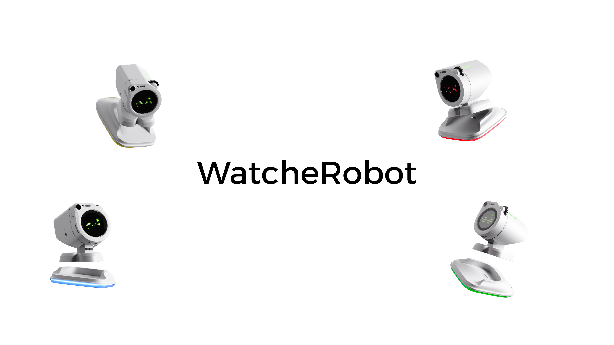

[English](README.md) | 简体中文

# WatcheRobot

WatcheRobot 是一款可编程的桌面机器人。它把屏幕表情、身体动作、灯光、声音和感知输入结合在一起，让你既能连接客户端体验交互，也能编写自己的机器人应用。

在线文档：**[wiki.orulink.ai](https://wiki.orulink.ai/)**。本仓库提供配套硬件资料、机械模型、SDK、烧录工具和使用文档；网站随正式 Release 更新，[维护与发布说明](wiki/README.md)。

## 产品介绍

WatcheRobot 面向桌面陪伴、互动展示和机器人应用开发。它不只是一个显示信息的屏幕：应用可以让机器人转头、改变表情、播放声音，并根据触摸、相机和麦克风输入作出响应。

- **表达与反馈**：用屏幕动画、代码表情、身体动作和灯效表达状态，配合音效或音频播放。
- **感知与互动**：读取背部触摸、屏幕点击和滚轮事件，使用摄像头拍照或读取麦克风音频。
- **组合体验**：在设备支持的情况下，实现人脸跟随、录音录像和实时音视频；语音对话由应用接入语音识别、语言模型与语音合成服务。
- **应用开发**：通过 Python SDK 组合设备能力，编写在电脑上运行的 Application；需要自行编写设备端逻辑时，可了解 C SDK 开发预览。
- **动手制作**：按公开硬件资料和机械模型制作、拼装自己的机器人，也可选择购买整机。

已有整机，直接从下方「快速开始」进入；想了解功能与接口，查看[机器人原子能力](wiki/guides/products/watcherobot/capabilities.md)；想搭建对话应用，查看[快速创建语音对话](wiki/guides/products/watcherobot/voice.md)。功能是否可用取决于设备、固件、SDK 和已安装资源；AI 服务需由应用配置，不代表设备内置通用大模型或默认可离线对话。

## 获取机器人

想直接体验整机，省去采购零件和自行组装的过程？**[前往京东预购 WatcheRobot](https://item.jd.com/100326823811.html)**（中国大陆购买渠道）。

海外购买平台即将上线，上线后会在这里补充链接。预购规则及预计发货时间以京东商品页说明为准。

想自己动手制作？请查看[复现指引](wiki/guides/guide/reproduction.md)，获取硬件资料、装配和烧录步骤。

## 项目预览

WatcheRobot 面向桌面陪伴、交互展示和开发者实验。整机由 Watcher 头部、ESP32-S3、STM32 身体主板、舵机、结构件和 SD 卡资源组成，可通过桌面端、手机 App 或 Python SDK 使用。

## 快速开始

适用于已有可用整机的用户，无需先克隆仓库、准备烧录工具或重新烧录。

1. **开机并安装客户端**：按[设备使用指南](wiki/guides/products/watcherobot/device-guide.md#install-app)下载适合电脑或手机的安装包。
2. **配置网络**：用手机 App 扫描设备二维码，完成[Wi-Fi 配网](wiki/guides/products/watcherobot/device-guide.md#wifi)。
3. **连接机器人**：电脑或 SDK 使用 Desktop Link；手机控制使用 Phone Control，见[连接说明](wiki/guides/guide/getting-started.md)。
4. **开始使用**：按[首次运行检查](docs/action-test_zh.md)验证表情、灯效和安全范围内的动作。

开发应用请看 [SDK 快速开始](docs/sdk_zh.md)，完整操作请看[设备使用指南](wiki/guides/products/watcherobot/device-guide.md)。

## 复现指引

想自己动手制作？请按[复现指引](wiki/guides/guide/reproduction.md)获取硬件资料和物料清单，完成装配、配套固件烧录与 SD 卡资源准备，再回到快速开始连接使用。

## 开发自己的嵌入式固件（开发预览，尚未公开发布）

除了通过 [Python SDK](docs/sdk_zh.md)编写上位机应用，我们也在准备面向
ESP32-S3 的独立硬件 SDK：开发者拥有自己的 `app_main`、UI 和业务逻辑，
通过统一接口使用身体运动、灯光、身体触摸，以及摄像头、麦克风、扬声器、
屏幕和屏幕触摸，不需要启动官方应用、Python SDK、Daemon 或服务端。

首版目标是提供身体、头部和整机三个可独立构建的 example；STM32 和 Himax
使用经过验证的配对固件，不要求开发者修改它们。详细边界和发布门禁见
[独立嵌入式开发说明](docs/embedded-sdk_zh.md)。

源码与三个示例位于 [firmware/sdk/](firmware/sdk/README_zh.md)，目前为开发预览，
尚未完成全部实机验收与固定版本发布。现有 Release 和烧录工具用于官方固件，
不能当作自定义固件的日常烧录入口。官方应用及 STM32/Himax 实现不在 SDK 开源范围内。

## 项目文档

- [烧录指南](docs/flashing_zh.md)：环境、接线、固件烧录、SD 卡和开机检查。
- [固件入口](firmware/README_zh.md)：各硬件对应的下载包和烧录入口。
- [SD 卡资源](docs/sd-card-assets_zh.md)和[首次运行检查](docs/action-test_zh.md)。
- [SDK 使用指南](docs/sdk_zh.md)：安装、配对和运行 Application。
- [独立嵌入式开发说明](docs/embedded-sdk_zh.md)：硬件 SDK 目标、示例与当前发布状态。
- [硬件资料](hardware/README_zh.md)：PCB 和机械文件入口。
- [设备使用指南](wiki/guides/products/watcherobot/device-guide.md)：开关机、扫码配网、连接电脑和手机。
- [机器人原子能力](wiki/guides/products/watcherobot/capabilities.md)、[快速创建语音对话](wiki/guides/products/watcherobot/voice.md)和[微信社区](wiki/guides/products/watcherobot/community.md)。
- [版本来源](docs/versions_zh.md)、[配套关系](docs/compatibility_zh.md)、[发布规则](docs/release-process_zh.md)和[仓库规则](docs/governance_zh.md)。
- [贡献指南](CONTRIBUTING_zh.md)和[安全策略](SECURITY_zh.md)。

## 开源范围

- 本仓库公开硬件生产文件、机械模型、Python SDK、烧录工具和说明文档。
- Python SDK 源码通过 `python-sdk/` 子模块提供。
- 官方 ESP32-S3 应用、Himax、STM32、App、服务端和桌面端实现不在本仓库公开；独立嵌入式硬件 SDK 以开发预览形式提供。
- 固件、客户端安装包和 SD 卡资源通过 GitHub Releases 分发。

## 技术栈

| 部分 | 技术或格式 |
| --- | --- |
| 头部 | Watcher、Himax、ESP32-S3 |
| 身体控制 | STM32F103、SWD / ST-LINK |
| SDK 与烧录工具 | Python、PowerShell、Bash |
| 硬件资料 | 原理图、PCB、BOM、CPL、Gerber、STEP |

## 许可证

本仓库使用 [GPL-3.0](LICENSE)。子项目和第三方组件以各自许可证为准。
