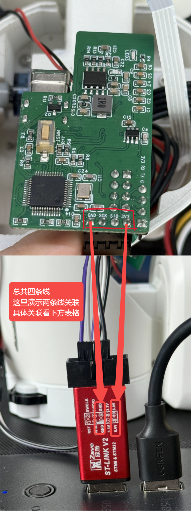

[English](flashing.md) | 简体中文

# 烧录与首次使用

材料见[物料与装配](../hardware/pcb/spares_zh.md)。已有可用整机无需为了配网而重新烧录，直接看[设备使用指南](../wiki/guides/products/watcherobot/device-guide.md)。

| 场景 | 选择 |
| --- | --- |
| 已有配套固件，只更新 ESP32-S3 | [网页烧录](#web)；先核对 Release 配套要求 |
| 新复刻、修复整套头部或安装完整配套版本 | [完整烧录](#full)：STM32、Himax、ESP32-S3 和 SD 资源 |
| 希望 AI 协助执行 | [发布固件烧录 Skill](../skills/watche-release-flash/SKILL_zh.md) |

## 网页烧录 ESP32-S3 {#web}

1. 在电脑 Chrome/Edge 打开 [ORULINK 烧录页](https://orulink.ai/pages/developer-flash.html)。用 USB 数据线连接头部的数据接口，关闭占用串口的桌面端和监视器。
2. 点击“选择设备端口”，选中设备并等待 ESP32-S3 检测通过。**SERIAL-B / CH342 B 是 ESP32，SERIAL-A / CH342 A 是 Himax**。如果都显示 USB Dual_Serial，不按 COM 编号大小判断；检测失败先断开，再尝试另一口。
3. 选择“官方固件”，核对版本后开始烧录。使用“本地固件”时，只选择适用于 ESP32-S3、从 `0x0` 写入的完整合并 `.bin`，不是 ZIP 或单独应用固件。
4. 保持供电和数据线连接，等待明确的成功结果和重启。若未启动，在写入结束后再按 RESET；不要刚到 100% 就拔线。
5. 按[首次运行检查](action-test_zh.md)确认实际效果。

网页只写 ESP32，不更新 STM32、Himax 或 SD 卡；不能替代首次完整安装。官方包会覆盖其对应分区，选择整片擦除还会清除其他设备数据；先备份需要保留的内容。初始化失败不等于固件不兼容，应先检查串口占用、线材、驱动和权限。

## 完整烧录：STM32、头部固件与 SD 卡资源 {#full}

### 1. 准备材料、文件和环境

准备身体 STM32 主板、Watcher 头部、ST-LINK V2、USB 数据线、SD 卡和读卡器。接线、插拔 SD 卡前先断电。

先[下载或克隆仓库](https://github.com/orulink-ai/WatcheRobot-public)，下列 `tools/` 命令来自仓库，不是固件包。再从 [Releases](https://github.com/orulink-ai/WatcheRobot-public/releases) 下载并解压相匹配的资源；按发布说明选择组合，不单凭版本数字：

| 附件名称包含 | 用途 |
| --- | --- |
| STM32 | 身体主板固件 |
| PTL-paired | 头部 Himax 和 ESP32-S3 完整固件及配套工具 |
| sd-resources | SD 卡表情、动作等资源；脚本也可自动下载最新包 |

使用已安装的 Conda；没有时先安装 [Miniconda](https://docs.conda.io/projects/miniconda/en/latest/)。在仓库根目录打开支持 Conda 的终端（Windows 可用 Anaconda PowerShell Prompt），只需创建一次专用环境：

```sh
conda create -n watcherobot python=3.12 pip -y
conda activate watcherobot
```

在仓库根目录运行以下命令，将固件路径替换为实际解压目录。依赖和烧录工具由脚本自动准备，首次运行需联网。

### 2. 烧录身体主板 STM32

用 ST-LINK V2 连接身体内部主板的四针接口，按印字对应，不按线色猜。



| 身体主板 | ST-LINK V2 |
| --- | --- |
| SIO | SWDIO |
| SCK | SWCLK |
| GND | GND |
| 3V3 | 3.3V，按实际供电方式确认 |

不要将 5V 接入 3V3；主板外部供电时，不要并接 ST-LINK 的 3.3V 电源输出。检查接线和供电后，将 ST-LINK 插入电脑。

Windows：

```powershell
powershell -NoProfile -ExecutionPolicy Bypass -File tools/flash.ps1 stm32 --package "解压后的STM32目录"
```

macOS/Linux：

```sh
bash tools/flash.sh stm32 --package "解压后的STM32目录"
```

依次看到 `Programming Finished`、`Verified OK`、`Resetting Target` 且成功结束后，断电移除 ST-LINK，再继续下一步。若连不上芯片，先断电核对两端接线。

### 3. 烧录头部 Himax 和 ESP32-S3

用 USB 数据线连接 Watcher 头部。先运行以下命令，脚本安装依赖并列出串口；此命令不写入固件：

Windows：

```powershell
powershell -NoProfile -ExecutionPolicy Bypass -File tools/flash.ps1 head --package "解压后的PTL-paired目录"
```

macOS/Linux：

```sh
bash tools/flash.sh head --package "解压后的PTL-paired目录"
```

在上一步输出中确认 SERIAL-B 和 SERIAL-A 对应的端口。Windows 的 `desc:` 名称与参数对应如下，以 COM61、COM62 为例：

| 设备名称 | 端口（示例） | 命令参数 |
| --- | --- | --- |
| USB-Enhanced-SERIAL-B CH342（ESP32） | COM61 | `--port COM61` |
| USB-Enhanced-SERIAL-A CH342（Himax） | COM62 | `--vision-port COM62` |

也可单独运行只读查询命令，不会写入固件：

```powershell
# Windows
Get-PnpDevice -PresentOnly -Class Ports | Where-Object { $_.FriendlyName -match 'SERIAL-[AB].*CH342' } | Select-Object FriendlyName
```

```sh
# 已完成上面的工具准备后，Windows/macOS/Linux 均可运行
python -m serial.tools.list_ports -v
```

Windows 还可在「设备管理器 → 端口（COM 和 LPT）」查看名称后括号中的 COM 号。只连接一台待烧录的 Watcher。

脚本会直接打印“设备名称 / 端口 / 命令参数”表。`--port` 填 SERIAL-B，`--vision-port` 填 SERIAL-A。将下面两处端口号替换为表中实际值后运行首次完整烧录：

```powershell
powershell -NoProfile -ExecutionPolicy Bypass -File tools/flash.ps1 head --package "解压后的PTL-paired目录" --port COM61 --vision-port COM62 --factory
```

macOS/Linux 完整烧录命令：

```sh
bash tools/flash.sh head --package "解压后的PTL-paired目录" --port "/dev/SERIAL_B" --vision-port "/dev/SERIAL_A" --factory
```

`/dev/SERIAL_B` 和 `/dev/SERIAL_A` 是占位路径，分别替换成查询到的 ESP32 和 Himax 串口路径；不要按端口数字大小判断。无法确认对应关系时，先不要烧录。

`--factory` 用于首次安装这套完整头部固件，确保 ESP32 分区表、应用和存储区来自同一发布包。它会覆盖 ESP32 中原有数据，不用于保留数据的日常升级。

一条命令自动完成：检查 → 烧录 ESP32-S3 → 启动并确认 Himax 供电初始化 → 烧录 Himax → 重启。无需中途输入确认或另行烧录。看到 `HX flash completed; reboot accepted.` 后继续等待，直到 `PTL paired flash completed.` 和 `Head flash completed successfully` 表示写入及重启指令完成，期间不要拔线。若失败，按日志标明的阶段排查；正常运行按第 5 步检查。

若串口未出现或无法访问，先停止：当前脚本尚不能自动处理 CH342 驱动和 Linux 串口权限。

### 4. 用读卡器准备 SD 卡

按 [SD 卡资源指南](sd-card-assets_zh.md)完成格式设置和资源写入，将卡插回头部后，继续下一步上电。

### 5. 上电并使用

确认 SD 卡和接线就位，接通电源并开机。按[设备使用指南](../wiki/guides/products/watcherobot/device-guide.md)配网：电脑/SDK 使用 Desktop Link，手机控制使用 Phone Control。首次进入时等待初始化完成。

BLE 连接成功只证明手机链路建立，不能证明 STM32、舵机、摄像头或扬声器都正常；仍要分别检查实际效果。

从 Release 下载 Desktop 或 Android 安装包；iOS 使用页面中的 TestFlight。Python 用户见 [SDK 指南](sdk_zh.md)。

连接后按[首次运行检查](action-test_zh.md)尝试一个表情、灯效和安全范围内的动作。

## 使用 Skill（可选）

用 AI 编程助手打开本仓库，告诉它：

> 读取 skills/watche-release-flash/SKILL_zh.md，使用已创建的专用 Conda 环境，确认固件目录和连接设备后执行烧录，报告真实结果。

不使用 AI 助手时，按上面的命令操作即可。
