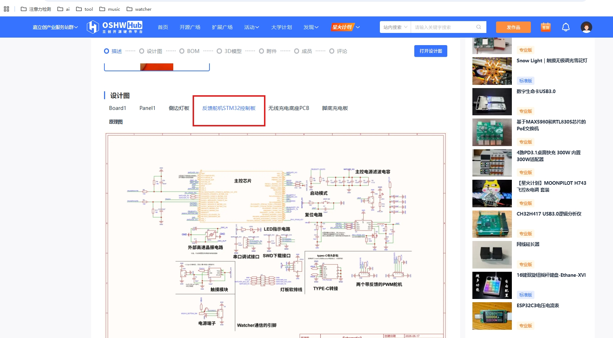
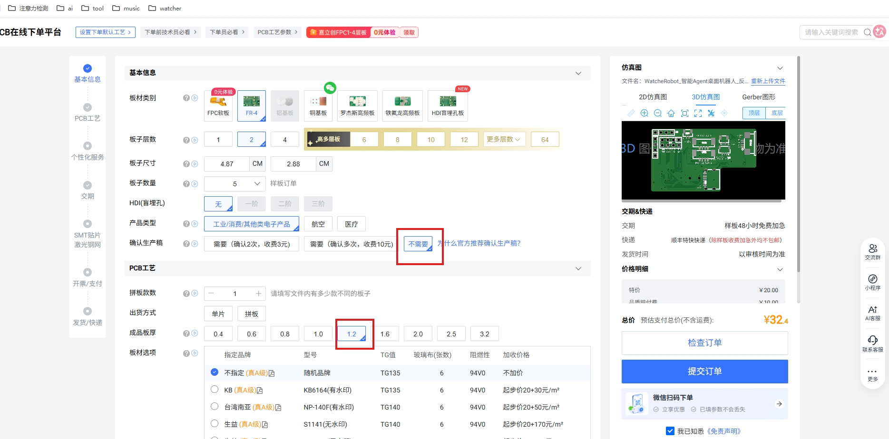
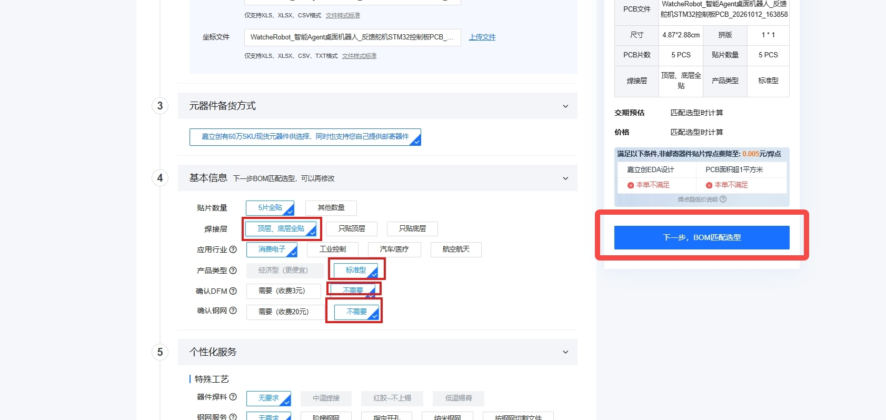

[English](pcb-fabrication.md) | 简体中文

# PCB 制作与 SMT 贴片

通过[立创开源硬件工程](https://oshwhub.com/team_efhmhuqf/project_gbxcghnl)制作所需板卡，板卡清单见[物料与装配](../hardware/pcb/spares_zh.md)。以下以 **STM32 控制板**为例；其他板卡需按各自设计核对参数。

## 1. 打开工程并导出 {#open-design}

在工程的“设计图”中选择目标板卡，点击“在编辑器中打开”，然后使用 **“导出 → PCB/FPC 一键打样”**。核对 DRC 检查结果后，导出 Gerber、BOM 和坐标文件，进入下单页面。

## 2. PCB 下单 {#pcb-options}

核对板框、尺寸、层数和板厚。下图示例为 **FR-4、2 层、1.2 mm、5 片**，数量按实际需求选择，不要将本例参数直接用于其他板卡。

需要工厂焊接元件时，选择“需要”SMT 贴片，再点击“提交pcb订单，去下smt”，完成订单检查并“确认并提交”。**PCB 订单只生产裸板，贴片还需继续下一步；自行焊接可只下裸板订单。**

首次下单或修改过设计，建议保留生产稿确认；价格、库存和交期以平台为准。

## 3. SMT 贴片 {#smt}

选择贴片数量和焊接层，点击“下一步，BOM匹配选型”。下图为 5 片、双面贴片示例，DFM 和钢网审核按实际需要与厂商确认。

使用同一版本的 Gerber、BOM 和坐标文件，重点核对**元件型号、封装、数量和极性**；缺料替代需确认兼容性。核对报价和收货信息后提交 SMT 订单。选择部分贴片时，剩余元件需自行采购、焊接。

## 4. 收货后装配 {#receive}

检查错件、漏件和焊接情况，断电确认无异常短路，再按[复现指引：装配与接线](../wiki/guides/guide/reproduction.md#assembly)继续。

完整下单截图见[飞书《如何获取 PCB 板子》](https://mcnsslrwxv50.feishu.cn/wiki/YSAlwY4EZiuR0jkYcu2ctHzKn3R)。
