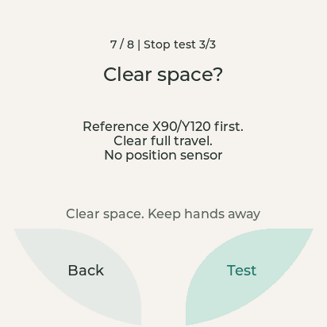

[English](hardware-check.md) | 简体中文

# 硬件体检：8 组、26 个细项，逐项人工确认

`hardware_check` 是独立 ESP32 示例，不是工厂认证或急停设备。
先完成[固定公开版本、构建、烧录和恢复准备](getting-started_zh.md)，不需要 Python SDK、
Daemon、服务端、SD 卡、模型或私库。从公开仓库根目录、已激活 ESP-IDF 6.0.2 的终端运行；
`<PORT>` 必须替换为确认过的 ESP32 端口，不是 Himax／STM32 端口：

```sh
idf.py -C firmware/sdk/examples/hardware_check build
idf.py -C firmware/sdk/examples/hardware_check -p <PORT> flash
idf.py -C firmware/sdk/examples/hardware_check -p <PORT> monitor
```

预期启动日志 `Hardware check v2 | curved zones`，屏幕显示 **Hardware check**。
Ctrl+] 退出 monitor。启动后不会自动开始任何测试。

## 操作顺序

点 **Test** 进入细项，先读提示，再点 **Test** 开始实际操作。看／听／触碰确认之后：
**Next** 接受当前细项，**Not OK** 记录问题。问题页 **Back** 重试、**Next** 保留问题继续。
缺失模块和 Skip 不能计为通过。屏幕左下／右下的整片浅色弧形区域均可点击，
不只是文字；中间留白和弧外不响应。最后 Results 两页各四组，可点组、再点细项复测。
新会话清空前会确认；结论只在 RAM，重启丢失。

| 组 | 实际操作 | 人工确认 |
| --- | --- | --- |
| 屏幕 | 按 1 → 2 → 3 | 可读、真实手指点击有响应 |
| 相机 | 3/2/1 倒计时拍照，再五秒实时画面 | 新图像与帧计数更新；照片可点开大图 |
| 扬声器 | 固定 CC0 语音，再一秒测试音 | 真实清晰可听，不能只看进度条 |
| 麦克风 | 倒计时后三秒录音，下一项单独 Replay | 原始电平随讲话变化，回放可听、不啸叫 |
| 身体触摸 | 同一真实传感器轻触释放，再长按释放 | Press → Release → Press → Long press → Release；不带动灯／电机 |
| 灯光 | Side／Bottom 各红绿蓝、暗亮、呼吸、关闭 | 14 项逐区、逐色／效果确认 |
| 运动 | 每次单独安全确认后执行轴运动与 STOP 测试 | 开环运动安全且实际停止；详见警告 |
| 组合 | 二十秒画面／固定语音／交替绿灯／事件分发 | 同时工作；没有电机，也不同时录音播放 |

## 运动：当前舵机没有物理反馈

旧 Check position／新鲜位置反馈前提已停用。`watcher_hw_body_request_position()`
返回 `ESP_ERR_NOT_SUPPORTED`；POSITION 旧 ABI 保留不代表测量。
每次操作前清空**完整行程**，保持可人工断电，在独立安全页明确确认。
当前先命令 **X90/Y120**，再命令 **X93/Y120** 或 **X90/Y123**。
物理起点未知，因此参考移动也可能是大行程，不是回零或校准；后续三度也只是命令差，
不能当成测量位移。详见[开环合同](servo-open-loop_zh.md)。

红色 **STOP** 在等待结果时仍保持红色，不能重复提交。匹配 `DONE/STOPPED`
只证明软件生命周期，仍须确认实物停住。停止测试若自然完成应记录问题。
运动错误保守锁定身体控制直到重启；断线无法送达 Stop，必须依赖 STM32 安全机制。



上图为真实 LVGL 主机渲染的界面示意，不是机器人实拍；不能据此宣称实机显示、触摸或运动验收通过。

## 声音、图像与取消

Speaker／Record／Replay 先进入 **Audio setup**：输出 0–95、默认 90、0 为静音。
回放目标固定 **32x**，峰值保护会降低实际倍数，播放显示实际值；只处理录音副本，
不修改麦克风模拟增益、不影响固定语音／测试音，也可能放大底噪。原始 PCM 不承诺降噪。
刺耳或啸叫立即停止。照片与录音仅在 RAM，固定语音为 flash 内许可素材，见
[素材来源](../examples/common/assets/README.md)。

**Stop** 要等待资源 owner 实际清理，不是立即物理停止证明。连点不能绕过清理门禁。
停止／drain 失败会禁用受影响模块，其他已就绪模块仍可用；attempt token 拒绝旧结果。
控制任务独占身体事件分发，不在 UI／摄像头回调中执行阻塞工作。

## 可选静默串口验证

先退出 monitor，确认只有验证器占用端口，期间不要触屏。从仓库根目录任选一个入口：

```sh
bash firmware/sdk/examples/hardware_check/verify.sh --port <PORT>
```

```powershell
./firmware/sdk/examples/hardware_check/verify.ps1 --port <PORT>
```

当前 IDF Python 需有 `pyserial`。可加 `--log <LOCAL_LOG_PATH>` 留本地证据。
验证反复拍照、取流清理、取消／复用和 PCM 采集，再返回**未测试**欢迎页。
不会烧录、扫描端口、驱动电机、播放声音或代替人工确认。退出码 0 完成、1 超时／结果不匹配、
2 参数错误；成功也不能宣称机械或声学验收。

monitor 支持 `diag status`、`diag photo`、`diag stream`、`diag record`、`diag cancel`、
`diag reset`、`diag snapshot`。故意不提供串口电机／灯／扬声器命令。
`diag reset` 不清除身体故障锁；RGB565 软件截图不证明手指触摸、声音或运动。
公开原始日志前检查设备标识与私人图像。

## 何时能说通过

记录公开 commit、SOURCE.json 的上游 SHA、构建／工具链、板卡、配对固件哈希、
日期／操作者及每项观察。Issue／Skip 不等于 Pass。无图、无声、丢事件、停不住或
不安全运动均记失败／阻塞，不要为了推进点 Next。host／真实 LVGL 回归不是实物测试，
[历史验收](../VALIDATION.md)也不能冒充当前快照新验收。官方恢复按
[公开上手指南](getting-started_zh.md)，不猜地址、不用私有 workspace 命令。
