English | [简体中文](../../../products/watcherobot/device-guide.md)

# Device user guide

Power on, configure Wi-Fi, and connect your robot to a computer or phone. Steps were checked against local ESP32 source `7699527` on 2026-10-15. Screenshots come from the existing device guide; layouts can vary by firmware and app version.

## Power and basic controls {#controls}

Press and hold the side dial for about **3 seconds** to power the device on or off.

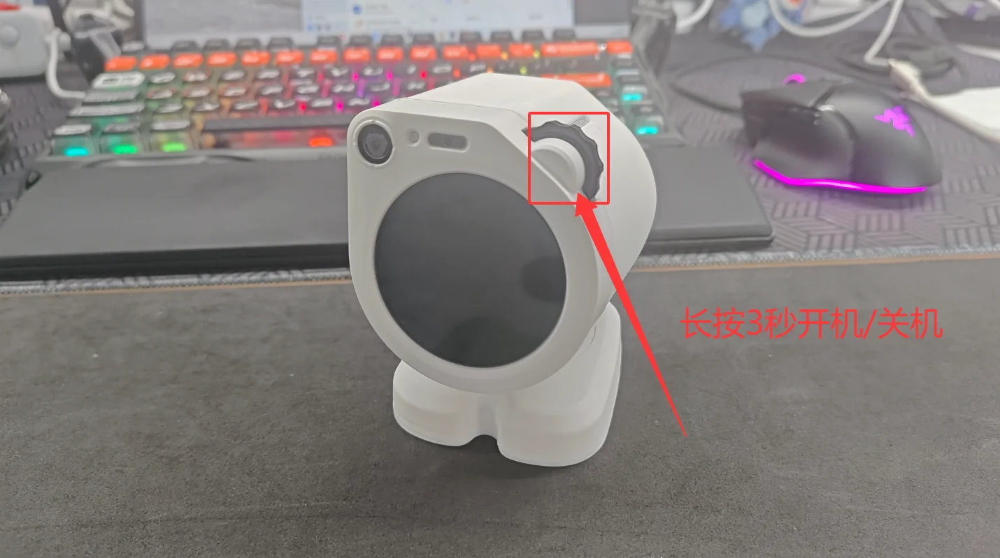

Scroll the dial to select a mode. Swipe inward from either edge of the screen to leave a mode.

<div class="device-guide-grid device-guide-controls">

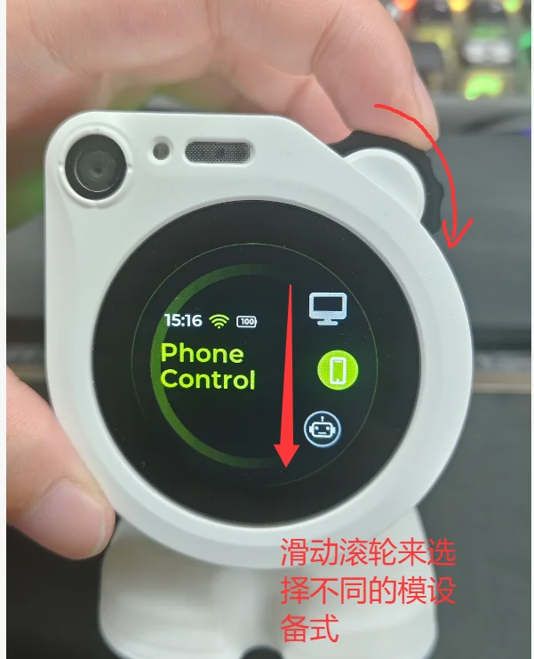

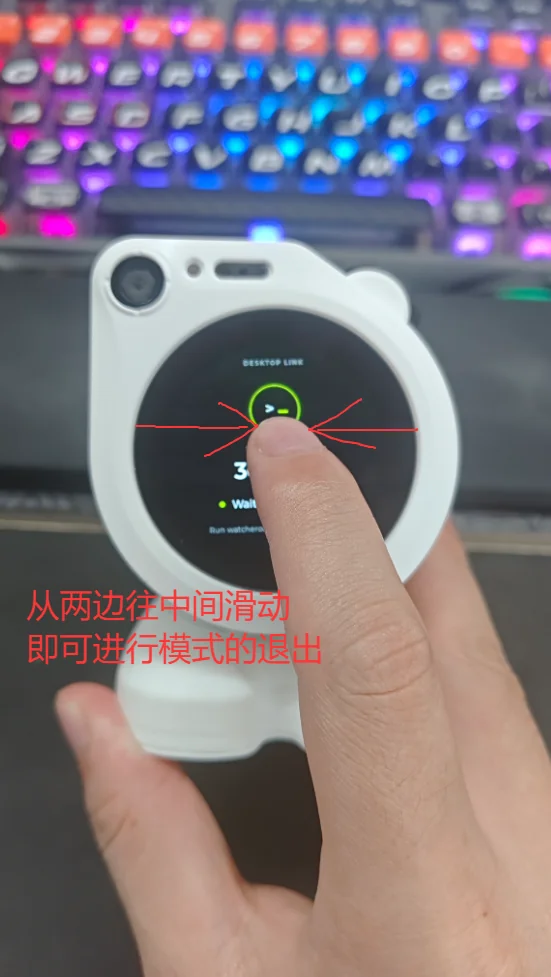

</div>

## Install a client {#install-app}

[Download the phone app from the public repository Releases](https://github.com/orulink-ai/WatcheRobot-public/releases)

Expand **Assets** in a release containing the phone app, download `watcher-android-*.apk`, and transfer it to your Android phone to install. Firmware-only releases do not include the app; look for an app or bundle release with an APK, not a firmware ZIP. For iOS, use [TestFlight](https://testflight.apple.com/join/XFCFsm5M); availability is determined by TestFlight.

Download Watcher Desktop from Releases too: use the appropriate `.exe` installer for Windows or a `.dmg` matching your Mac's chip architecture. Availability follows the actual assets. APKs, firmware ZIPs, and SDK wheels are not desktop installers.

## Configure Wi-Fi with a QR code {#wifi}

### 1. Display the QR code on the robot

On first boot without saved Wi-Fi credentials, the robot opens provisioning automatically. You can also open **Settings → Wi-Fi**. Wait for Bluetooth advertising to be ready before scanning **Scan QR**.

Enable phone Bluetooth and grant the app Bluetooth and camera permissions. Scan **inside the WatcheRobot app**, not WeChat or the system camera. The code identifies the robot and does not contain your Wi-Fi password. A connected robot shows network details instead. Use **Disconnect** only to change networks: it clears the saved Wi-Fi credentials.

<div class="device-guide-grid">

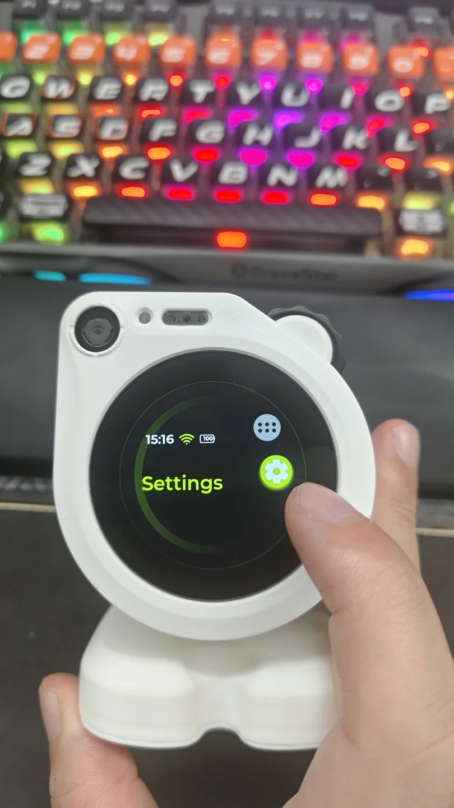

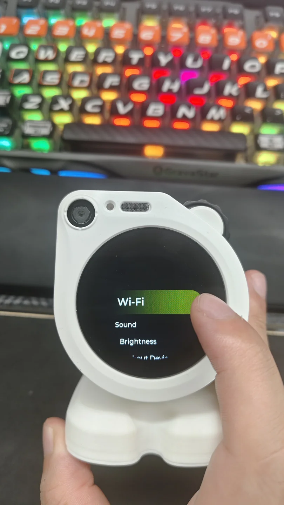

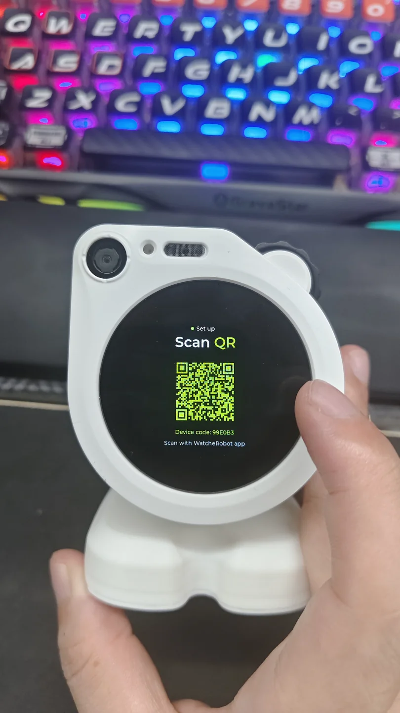

</div>

### 2. Scan with the phone app

Open the app, tap **Scan QR code**, and scan the code on the robot's screen. Wait while the app searches for the device.

<div class="device-guide-grid">

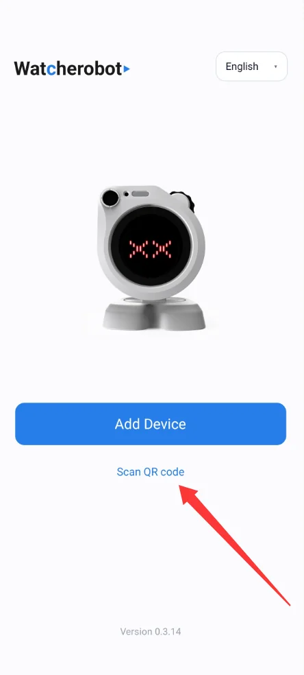

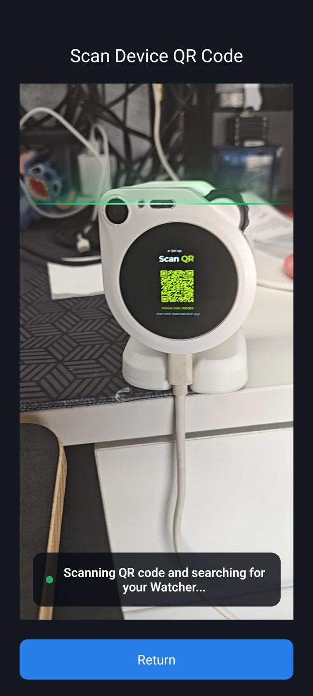

</div>

### 3. Select a network and connect

Select your Wi-Fi network, or tap **Enter network manually** to enter its name. Enter the Wi-Fi password and wait for **Connected successfully**. Confirm **Connected** and an IP address on the robot. A wrong password or timeout is not success; follow the app error to retry.

Provisioning is separate from phone control. After success notification and Bluetooth release by the app, the robot can return home; a manually opened Wi-Fi information page may stay open.

<div class="device-guide-grid">

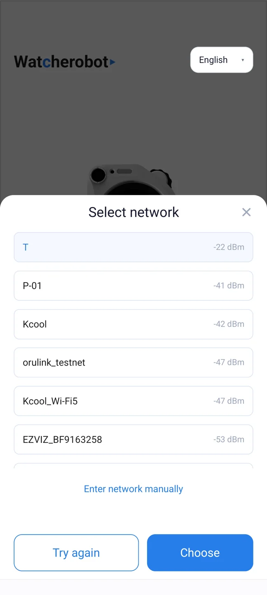

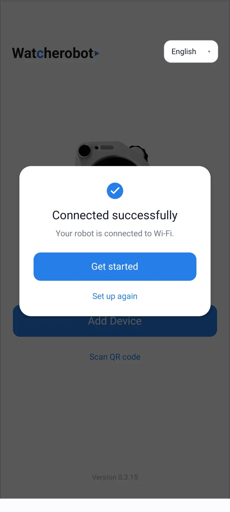

</div>

::: tip
Do not provision again if the robot is already on the correct Wi-Fi. Before connecting a computer, make sure it and the robot are on the same local network.
:::

SDK provisioning is also available; see the local [Python SDK quick start](../../../../../docs/sdk.md). Installing the SDK is not required for phone QR provisioning.

## Connect a computer and SDK {#desktop}

1. Connect the computer and robot to the same local network.
2. Open **Desktop Link** on the robot.
3. Read the six-digit **PAIR CODE** shown on screen.

<div class="device-guide-grid">

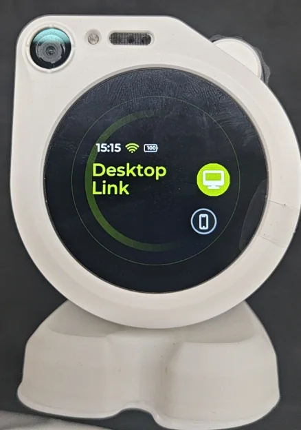

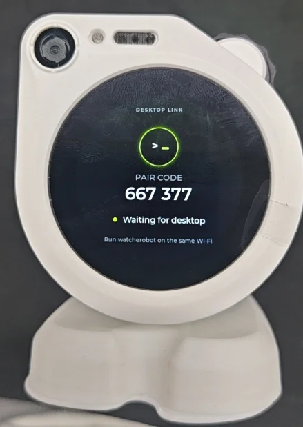

</div>

In Watcher Desktop, enter the code when prompted. For SDK access, first follow the [Python SDK installation instructions](../../../../../docs/sdk.md), then run:

```bash
watcherobot robot pair 123456
```

Replace `123456` with the robot's current code, not the example in the screenshot. Run `watcherobot robot status` to confirm the device is connected; saved pairing alone does not mean it is online.

See [Client and device](../../guide/client-and-device.md) for connection states.

## Connect a phone {#phone}

1. Open **Phone Control** on the robot.
2. Read the **Device ID** on its screen.
3. Open the phone app, tap **Add Device**, select the matching Device ID, and follow the app prompts.

<div class="device-guide-grid">

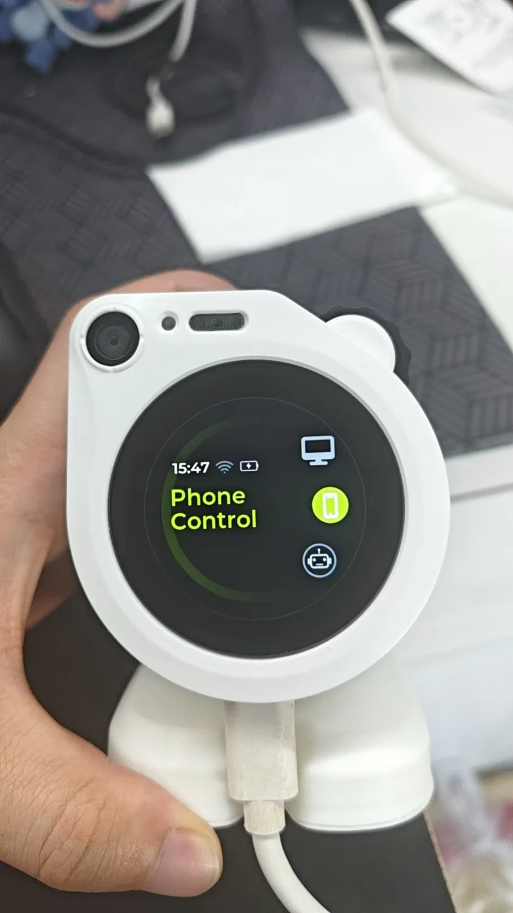

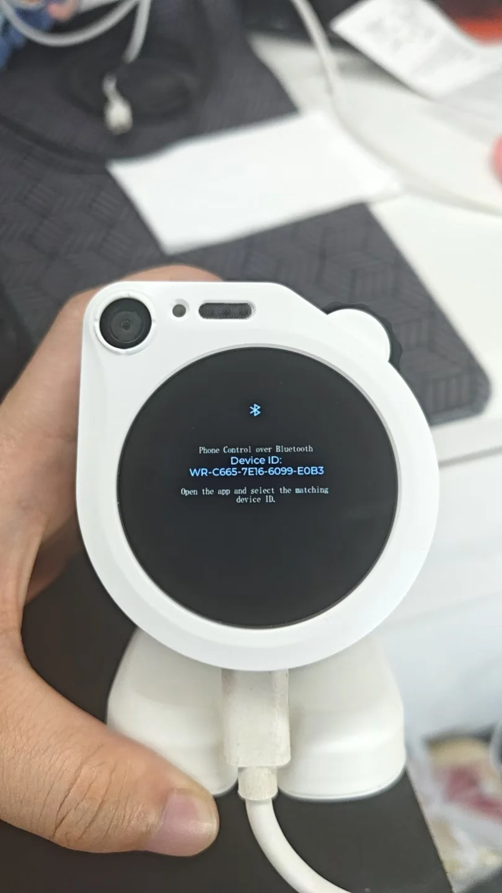

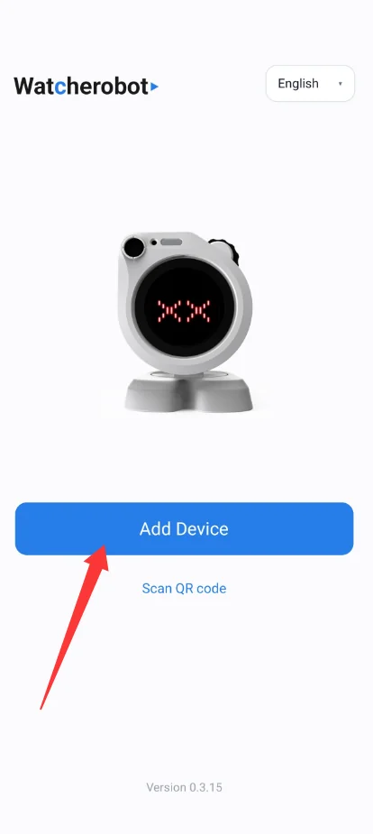

</div>

**Scan QR code** configures Wi-Fi; **Add Device** connects phone control mode. They are different actions.

For connection problems, see [Troubleshooting](../../troubleshooting/index.md).

Need a firmware update? Read the [flashing guide](../../../../../docs/flashing.md). Join our [WeChat community](community.md) to discuss usage and development.
